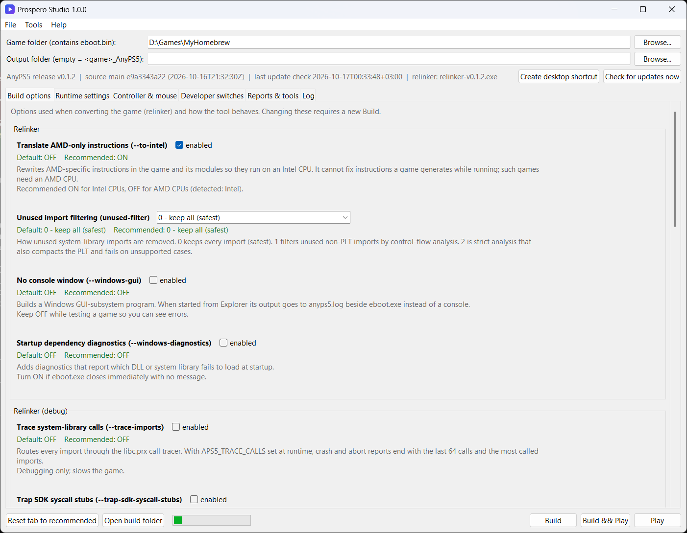

# Prospero Studio

**A Windows front end for [AnyPS5](https://github.com/boykopovar/AnyPS5): run PS5 homebrew and games you dumped
from your own console, with every AnyPS5 setting in one window, automatic updates and ready-made reports for
the AnyPS5 developers.**


[](https://github.com/SlickAlex1)

## What is this?

[AnyPS5](https://github.com/boykopovar/AnyPS5) is an open-source project that *relinks* PS5 programs into
native Windows and Linux programs and reimplements the PS5 system libraries they call. It is not an emulator,
and using it by hand takes many steps: unwrapping files, finding module folders, running the relinker with
the right flags, copying libraries, setting environment variables.

**Prospero Studio does those steps for you.** Point it at a folder you dumped from your own PS5 (a homebrew
app or a game you own), press **Build & Play**, and it prepares a Windows build next to it. It keeps AnyPS5
up to date, shows every option AnyPS5 has with its default and a recommendation, tells you in plain words why
a game stopped, and writes the reports AnyPS5's developers ask for. *Prospero* is the PS5's internal
codename.

<p align="center"></p>

| ✅ What it is | ❌ What it is not |
|---|---|
| A launcher and automation script written from scratch in Python | Not an emulator, not AnyPS5 itself |
| A front end that runs AnyPS5 and PS5-SELF-TO-ELF with their documented options | Not a source of games: it contains and downloads **no game files** and links to none |
| A way to test PS5 homebrew and games **you legally own** on a PC | Not a decryption tool: it contains **no keys** and works only on files that are already decrypted |
| A helper for reporting compatibility and performance to AnyPS5 | Not affiliated with Sony, AnyPS5 or PS5-SELF-TO-ELF, and contains no Sony code |

> [!NOTE]
> Made for software preservation, homebrew development, interoperability research and compatibility testing.
> Read the [DISCLAIMER](DISCLAIMER.md) before use.

---

## Features

### One-click builds
- **Folder in, Windows build out**: pick a folder containing `eboot.bin`; it creates `<Game>_AnyPS5` beside
  it and never modifies the original.
- **The full AnyPS5 workflow**: unwraps decrypted SELF containers (AnyPS5's `unwrap_self.py` or
  [PS5-SELF-TO-ELF](https://github.com/julienlgy/PS5-SELF-TO-ELF)), finds bundled module folders (`sce_module`,
  `prx`, Unity `Media/Modules` and `Media/Plugins` ...), relinks, copies the system libraries and runtime DLLs,
  and runs the import audit.
- **Fixes common dump problems**: repairs an invalid `param.json` memory setting, skips backup copies
  (`*.bak`, `*.esbak` ...) that would confuse the relinker, and keeps the previous build as a backup.

### Every setting, explained
- **Build options** (all relinker flags), **runtime settings** (language, GPU, present mode, shader cache,
  compatibility fixes, diagnostics), **controller & mouse** (built-in layout, key capture, deadzones,
  mouse-as-stick) and **developer switches** (hundreds of `APS5_*` switches found in the AnyPS5 source).
- Each shows **AnyPS5's default, the recommended value and what it does**; options the installed release
  does not support are greyed out. Settings are remembered per game, and each build gets a `play.bat`.

### For testers and AnyPS5 developers
- **Run analysis** after every Play: frame rate, and the reason a game stopped (unimplemented function by name,
  GPU without mesh shaders, `param.json`, memory, CPU features, driver crash, freeze).
- **Game bring-up report** in the format of AnyPS5's discussion template, with title, version, release,
  system, driver, blocker, stubs and the exact flags; one click searches the title's existing thread.
- **Performance capture** following AnyPS5's performance-issue protocol (`APS5_TRACE_SECONDS`,
  `aps5-summary.jsonl`, `tools/trace_digest.py`), formatted as a `perf:` issue.
- **Release pinning**: build with older AnyPS5 releases to report *works in vX, broken in vY*.

Nothing is ever posted for you: reports are copied to the clipboard and you post them yourself.

### Command line and JSON API
Everything the window does is also a command, with `--json` output and fixed exit codes, so scripts,
frontends and CI can drive it:

```bat
python prospero info --json
python prospero build "D:\Games\MyHomebrew" --set backup=off --json
python prospero play "D:\Games\MyHomebrew_AnyPS5" --seconds 60 --json
```

See **[docs/CLI.md](docs/CLI.md)** for every command and field.

### Always up to date
Before each build it checks the upstream projects and downloads only what changed:

| Upstream | Kept current | When |
|---|---|---|
| [AnyPS5](https://github.com/boykopovar/AnyPS5) `main` | source, `unwrap_self.py`, `import_audit.py`, setting list | every new commit |
| [AnyPS5 releases](https://github.com/boykopovar/AnyPS5/releases) | `relinker.exe` + Windows libraries (matched, SHA-256 verified) | every new release |
| [PS5-SELF-TO-ELF](https://github.com/julienlgy/PS5-SELF-TO-ELF) | `self_to_elf.py` | every new commit |

---

## Requirements

| | |
|---|---|
| OS | Windows 10 or 11, 64-bit |
| Python | 3.10 or newer from [python.org](https://www.python.org/downloads/) (Tkinter is included) |
| CPU | x86-64 with AVX2, FMA, F16C, BMI1/2, LZCNT and MOVBE (Intel Haswell / AMD Zen or newer) |
| GPU | Vulkan 1.1. **Many games also need mesh shaders**: NVIDIA GTX 16xx / RTX 20 or newer, AMD RX 6000 or newer, Intel Arc ([details](docs/TROUBLESHOOTING.md#subgroup-capability-61-is-unsupported-for-shader-stage-128)) |
| Software to run | A **decrypted** folder **you dumped from your own console**: homebrew or a game you own |
| Disk | About 100 MB for AnyPS5, plus a copy of each title you build |

---

## Quick Start

1. **Code -> Download ZIP** and extract it, or `git clone https://github.com/SlickAlex1/Prospero-Studio.git`.
2. Double-click **`Prospero Studio.pyw`**, the only file to open. On the first build it downloads AnyPS5 and
   PS5-SELF-TO-ELF into `runtime/` by itself. **File -> Create desktop shortcut** adds a desktop and Start
   menu icon.
3. **Browse...** to the folder that contains `eboot.bin`.
4. **Build & Play**. The coloured *Log* tab shows every step; the title starts in its own window.

Afterwards, **Play** starts the existing build with changed runtime settings (no rebuild), or double-click
`play.bat` in the build folder.

> [!IMPORTANT]
> **Antivirus**: some antivirus products (Bitdefender in particular) flag the official AnyPS5
> `relinker.exe` with a generic detection and may remove it or the built `eboot.exe`. Compare the checksum
> with the AnyPS5 release page and add an exception for the folder, see
> [Troubleshooting](docs/TROUBLESHOOTING.md#antivirus-removes-files).

---

## What a build looks like

```
MyGame_AnyPS5/
├── eboot.exe              converted program (Windows PE)
├── play.bat               starts eboot.exe with your runtime settings
├── anyps5-input.ini       only when you changed controller/mouse settings
├── anyps5_run.log         log of the last run
├── libs/                  AnyPS5 system libraries (*.prx) + MinGW runtime DLLs
├── app0/                  the title's files, original eboot.bin included
│   └── sce_module/        converted modules (*.guest.prx)
└── import_audit.json      which imported functions AnyPS5 implements / stubs / lacks
MyGame_AnyPS5_setup.log    full build log
```

## Repository layout

```
Prospero Studio.pyw     the app: double-click this
prospero/               code
  anyps5_gui.py           the window (Tkinter)
  anyps5_folder.py        build engine
  cli.py, __main__.py     command line / JSON API (python prospero ...)
  anyps5_settings.py      catalog of every setting: defaults, recommendations, descriptions
  anyps5_reports.py       run analysis, bring-up and performance reports
  update_anyps5.py        downloads and updates AnyPS5 and PS5-SELF-TO-ELF
  branding.py, paths.py   name, version, banner; where code and runtime data live
  icon.ico / icon.png     app icon (drawn by scripts/make_icon.py)
runtime/                created on first start, never committed: AnyPS5, tools, settings, update state
docs/                   CLI.md, SETTINGS.md (generated), TROUBLESHOOTING.md, screenshot.png
scripts/                generate_settings_doc.py, make_icon.py
```

---

## FAQ

**Is this an emulator?** No. AnyPS5 converts PS5 programs into Windows programs and supplies reimplemented
system libraries; Prospero Studio automates that and adds a settings window, reports and an API.

**Where do I get games?** From your own console, by dumping software you own. This project does not provide,
link to or help find games, and issues asking for them are closed.

**Can it decrypt my dump?** No. It contains no keys and only works with files that are already decrypted.

**Will every game run?** No. That depends on AnyPS5's progress. A successful build means the title was
converted; the run analysis tells you why one stops, and the bring-up report helps the AnyPS5 developers.

**Why does my antivirus complain?** Tools that rewrite executables often trigger generic detections. All
binaries come from AnyPS5's official releases and are checked against their published SHA-256.

---

## Credits

| Project | Author | Role |
|---|---|---|
| [AnyPS5](https://github.com/boykopovar/AnyPS5) | [boykopovar](https://github.com/boykopovar) and contributors | Relinker, PS5 system libraries for Windows, `unwrap_self.py`, `import_audit.py` (GPL-2.0-only) |
| [PS5-SELF-TO-ELF](https://github.com/julienlgy/PS5-SELF-TO-ELF) | [julienlgy](https://github.com/julienlgy) | `self_to_elf.py` SELF/PRX to ELF converter (no license published; downloaded from the author's repository, never redistributed) |
| Prospero Studio | [SlickAlex](https://github.com/SlickAlex1) | This tool: automation, settings window, reports, API, updater |

## Legal

- Use only with software you own and dumped from your own console, where the law of your country allows it.
- This repository contains **no game content, no keys, no Sony code and no third-party binaries**; AnyPS5 and
  PS5-SELF-TO-ELF are downloaded from their official repositories on your machine (see [NOTICE](NOTICE)).
- It does not decrypt anything and does not circumvent copy protection.
- Do not post game files, download links or keys in issues or pull requests; they are removed.
- PlayStation and PS5 are trademarks of Sony Interactive Entertainment Inc., used only to describe
  compatibility. Not affiliated with or endorsed by Sony. Full text: [DISCLAIMER](DISCLAIMER.md).
- Rights holders: please open an issue or contact [SlickAlex](https://github.com/SlickAlex1).

## License

Copyright (C) 2026 [SlickAlex](https://github.com/SlickAlex1). Free software under the
[GNU General Public License v3.0 or later](LICENSE).
